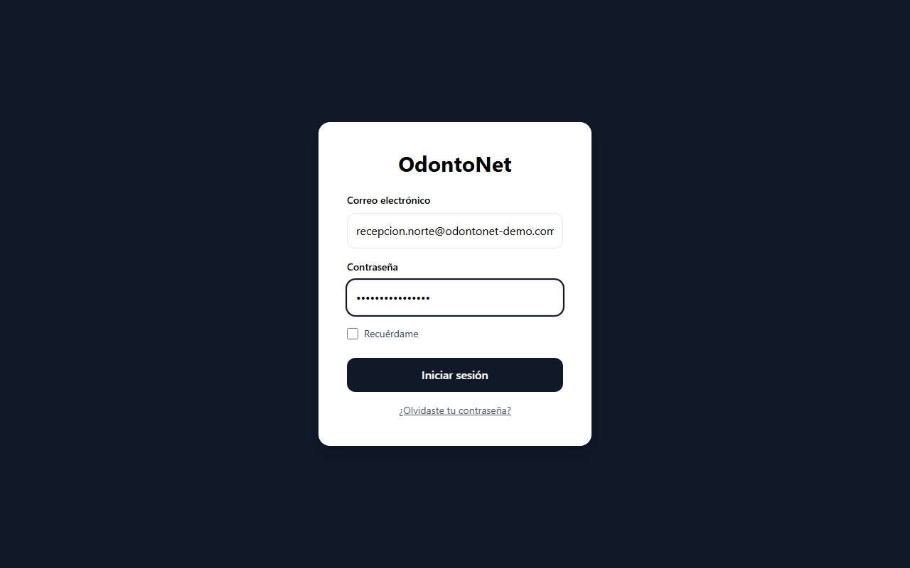
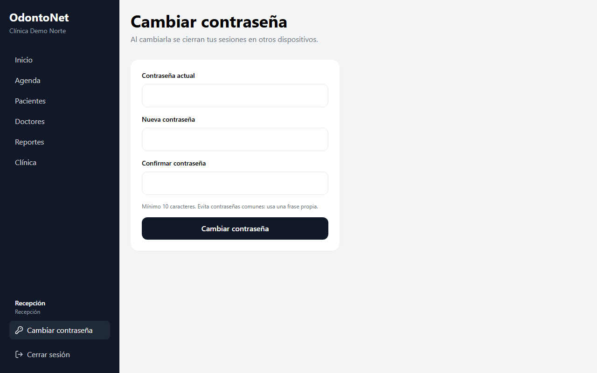
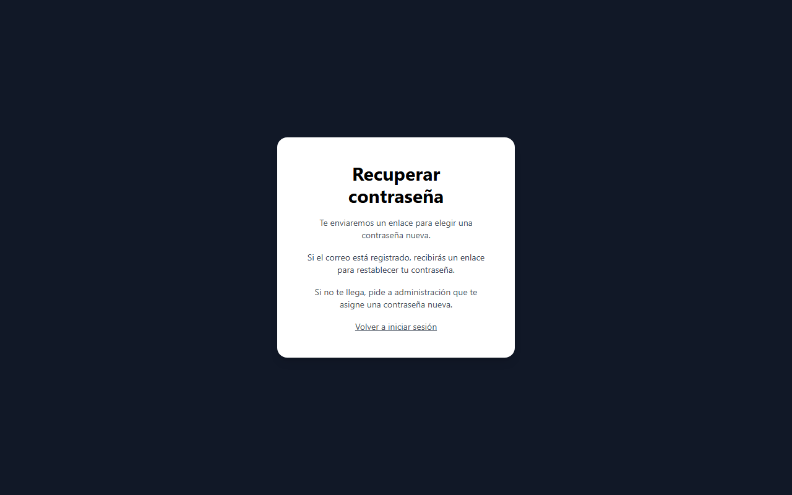

# Manual de usuario de OdontoNet

OdontoNet es el sistema para gestionar la agenda, los pacientes y el expediente clínico de la clínica. Este manual explica, paso a paso, lo que puede hacer cada persona según su rol.

Las capturas usan datos ficticios: ningún nombre, teléfono o fotografía corresponde a una persona real. Las fechas y las cantidades que veas en tu clínica serán distintas.

## Índice

| Si tu rol es | Lee | Encontrarás |
| --- | --- | --- |
| Recepción | [Manual de recepción](recepcion.md) | Agenda, pacientes, horarios de los doctores y reportes |
| Doctor | [Manual del doctor](doctor.md) | Expediente clínico: historia médica, consultas, tratamientos, imágenes y periodontograma |
| Administración | [Manual de administración](administracion.md) | Usuarios, contraseñas, doctores, datos de la clínica, reportes y Auditoría |

Antes de seguir con tu manual, revisa los primeros pasos de esta página: son iguales para todos.

## Primeros pasos

### Qué necesitas

- Un navegador actualizado (Chrome, Edge o Firefox).
- La dirección de OdontoNet de tu clínica.
- Tu correo y tu contraseña. Te los entrega la administración de tu clínica.

### Iniciar sesión

1. Abre la dirección de OdontoNet en tu navegador.
2. Escribe tu **Correo electrónico** y tu **Contraseña**.
3. Si estás en tu equipo de trabajo y quieres seguir conectado, marca **Recuérdame** (se explica a continuación).
4. Pulsa **Iniciar sesión**.

Si los datos no son correctos, verás un aviso y deberás escribir de nuevo la contraseña. Después de varios intentos fallidos, el sistema bloquea temporalmente el acceso; espera unos minutos antes de volver a intentar.

### Qué hace «Recuérdame»

| | Sesión | Recomendación |
| --- | --- | --- |
| **Sin marcar** | Se termina al cerrar el navegador y, en todo caso, a las 12 horas. | Úsalo en equipos compartidos. |
| **Marcada** | Sigue abierta aunque cierres el navegador, hasta por 7 días. | Úsalo solo en un equipo de tu uso personal y con clave de acceso. |

En un equipo compartido con otras personas, no marques esta casilla.

### Conocer la pantalla

Al entrar verás **Inicio**. A la izquierda está el menú; arriba aparece el nombre de tu clínica y abajo, tu nombre, tu rol y las opciones **Cambiar contraseña** y **Cerrar sesión**.

El menú muestra solo lo que tu rol puede usar:

| Opción del menú | Recepción | Doctor | Administración |
| --- | :---: | :---: | :---: |
| Inicio | Sí | Sí | Sí |
| Agenda | Sí | Sí | Sí |
| Pacientes | Sí | Sí | Sí |
| Doctores | Sí | Sí | Sí |
| Reportes | Sí | Sí | Sí |
| Usuarios | No | No | Sí |
| Clínica | Sí | Sí | Sí |
| Auditoría | No | Sí | Sí |

Si abres una dirección que tu rol no permite, verás el mensaje **Acceso denegado** y el botón **Volver al inicio**. Si crees que deberías tener acceso, habla con la administración de tu clínica.

En OdontoNet cada persona ve únicamente la información de su propia clínica.

### Cambiar tu contraseña

Te recomendamos cambiar la contraseña que te entregó administración la primera vez que entres.

1. En la parte inferior del menú, pulsa **Cambiar contraseña**.
2. Escribe tu **Contraseña actual**.
3. Escribe tu **Nueva contraseña** y repítela en **Confirmar contraseña**. Debe tener al menos 10 caracteres. Evita contraseñas comunes: usa una frase propia.
4. Pulsa **Cambiar contraseña**.

Al cambiarla, se cierran tus sesiones abiertas en otros dispositivos; en el equipo que estás usando sigues conectado.

### Cerrar sesión

Pulsa **Cerrar sesión** en la parte inferior del menú. Hazlo siempre que dejes un equipo compartido.

### Si olvidaste tu contraseña

1. En la pantalla de inicio de sesión, pulsa **¿Olvidaste tu contraseña?**
2. Escribe tu **Correo electrónico** y pulsa **Enviar enlace**.
3. Revisa tu correo. Si la dirección está registrada, recibirás un enlace que vence en 30 minutos.
4. Abre el enlace, escribe tu **Nueva contraseña**, repítela en **Confirmar contraseña** y pulsa **Guardar contraseña**.
5. Vuelve a iniciar sesión con la contraseña nueva.

**Si no te llega el correo** (revisa también la carpeta de correo no deseado), pide a administración que te asigne una contraseña nueva. Es la opción normal cuando la clínica no tiene configurado el envío de correos. Administración te la entrega y tú la cambias después desde **Cambiar contraseña**.

Si el enlace ya venció o ya se usó, verás un aviso con la opción **Solicitar un enlace nuevo**.

## Cuidado de la información

- No compartas tu contraseña ni uses la de otra persona: el sistema registra quién hace cada cambio.
- Cierra sesión o bloquea el equipo cuando te alejes de él.
- Las pantallas y documentos de OdontoNet contienen datos personales y de salud. No los fotografíes ni los envíes por medios no autorizados por tu clínica.
