# Manual de administración

Con el rol **Administración** gestionas al personal, los doctores y los datos de tu clínica, además de consultar la auditoría y exportar reportes. Para iniciar sesión, cambiar tu contraseña o recuperarla, consulta los [primeros pasos](README.md).

Administración también tiene acceso a la agenda, los pacientes y el expediente clínico, porque en muchas clínicas quien administra también atiende. Esas tareas se realizan igual que en el [manual del doctor](doctor.md), con estas diferencias:

- Puedes editar o anular consultas, fotografías y periodontogramas registrados por cualquier persona.
- Puedes editar el horario de cualquier doctor.
- Puedes ver quién abrió cada fotografía clínica (consulta [Accesos a las fotografías](#accesos-a-las-fotografías)).

Todo lo que administras se limita a tu propia clínica.

## Inicio

Muestra indicadores de toda la clínica y la **Agenda de hoy**. Elige el **Periodo** o un **Doctor** para filtrar, y pulsa **Mostrar más indicadores** para ver más cifras.

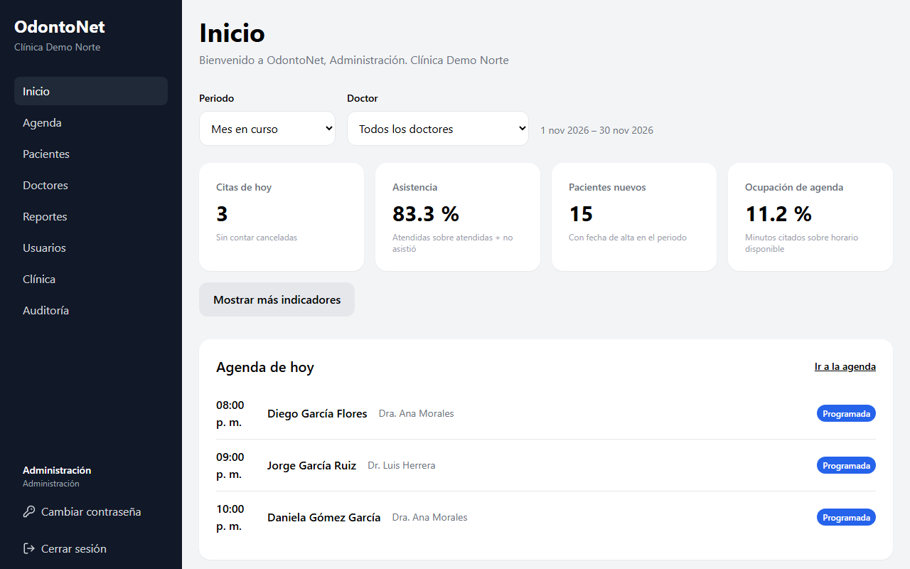

## Usuarios

En el menú, pulsa **Usuarios**. Puedes buscar por nombre o correo y filtrar por rol y estado.

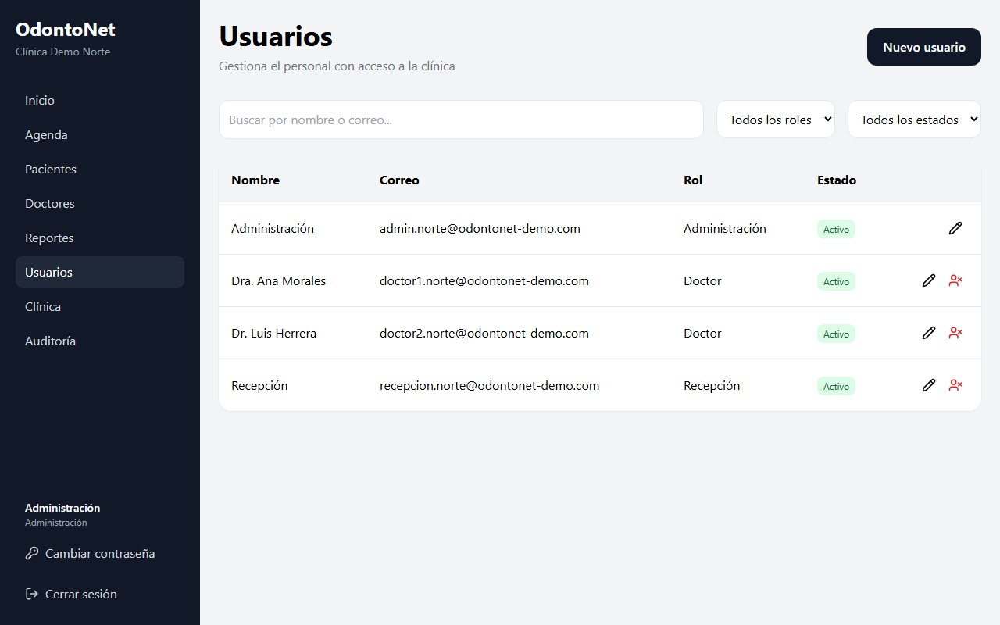

### Crear un usuario

1. Pulsa **Nuevo usuario**.
2. Escribe **Nombre completo** y **Correo electrónico**. El correo es el que usará para iniciar sesión y no puede estar registrado para otra persona.
3. Elige el **Rol**: **Administración**, **Doctor** o **Recepción**. Cada usuario tiene un solo rol.
4. Escribe una **Contraseña** inicial de al menos 10 caracteres. Evita contraseñas comunes.
5. Pulsa **Crear usuario**.
6. Entrégale la contraseña a la persona por un medio seguro y pídele que la cambie al entrar.

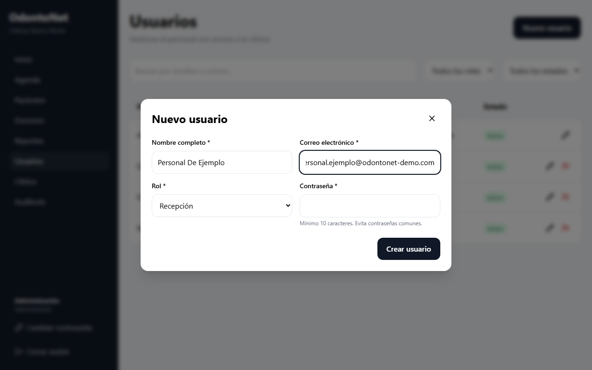

Si la persona atiende pacientes, crea además su [perfil de doctor](#doctores).

### Editar un usuario

1. Pulsa el icono de lápiz en su fila.
2. Cambia los datos necesarios.
3. Pulsa **Guardar cambios**.

Si cambias el correo de una persona, deberá iniciar sesión de nuevo con el correo nuevo. No puedes cambiar tu propio rol, y el rol de un usuario con perfil de doctor no se puede cambiar mientras exista ese perfil.

### Asignar una contraseña nueva

Úsalo cuando alguien olvidó su contraseña y no le llegó el correo de recuperación.

1. Pulsa el icono de lápiz en la fila de la persona.
2. Escribe la **Nueva contraseña**, de al menos 10 caracteres. Si dejas el campo vacío, se conserva la actual.
3. Pulsa **Guardar cambios**.
4. Entrégale la contraseña por un medio seguro y pídele que la cambie desde **Cambiar contraseña**.

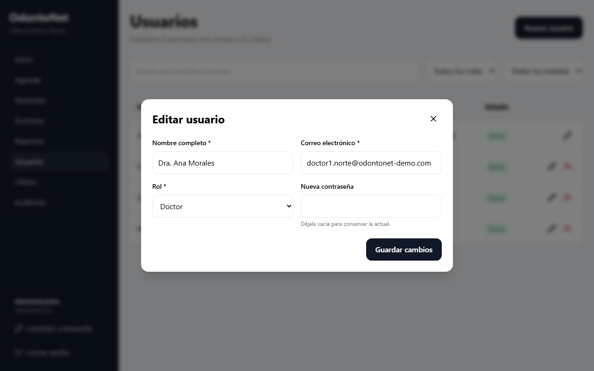

Al asignarla se cierran todas las sesiones abiertas de esa persona y se anulan sus enlaces de recuperación pendientes.

Para tu propia contraseña usa **Cambiar contraseña** en el menú: este formulario no la cambia.

### Desactivar y activar personal

Cuando alguien deja de trabajar en la clínica, desactívalo en lugar de buscar cómo eliminarlo.

1. Pulsa el icono de desactivar (persona con una X) en su fila.
2. Lee el aviso y pulsa **Desactivar**.

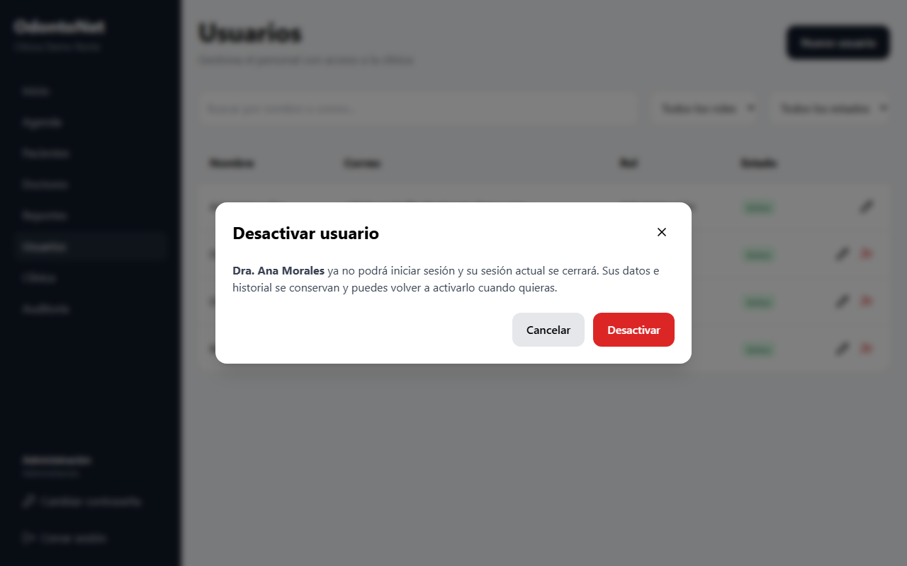

Desde ese momento la persona no puede iniciar sesión y su sesión actual se cierra. Sus datos e historial se conservan. Si tenía perfil de doctor, sigue apareciendo en el historial y en sus citas, pero no se le pueden asignar pacientes ni citas nuevas.

Para volver a darle acceso, filtra por **Inactivos**, pulsa el icono de activar y confirma con **Activar**. Podrá entrar con su contraseña actual. No puedes desactivar tu propio usuario.

## Doctores

En el menú, pulsa **Doctores**. Usa el filtro para ver **Activos**, **Inactivos** o **Todos**.

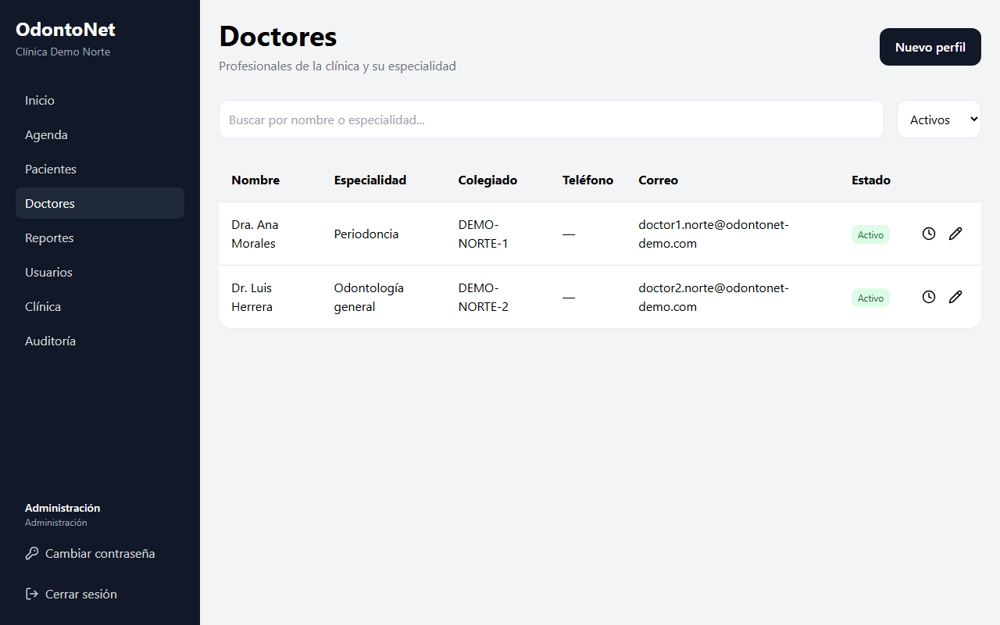

### Crear un perfil de doctor

El perfil permite asignarle pacientes y citas. Primero debe existir el usuario, con rol Doctor o Administración.

1. Pulsa **Nuevo perfil**.
2. En **Usuario**, elige a la persona.
3. Completa **Especialidad**, **Número de colegiado** y **Teléfono**.
4. Pulsa **Crear perfil**.

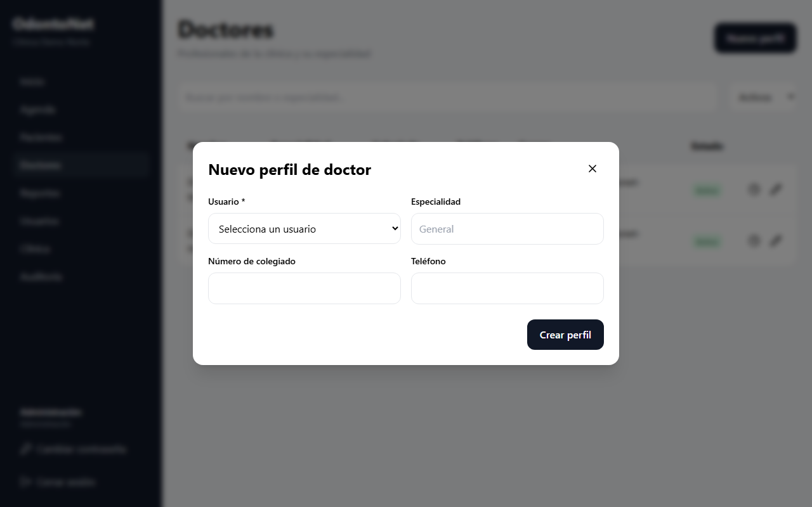

Si aparece el aviso de que todos ya tienen perfil, crea primero el usuario en **Usuarios**.

Para editar un perfil, pulsa el icono de lápiz en su fila y luego **Guardar cambios**. El nombre, el correo y el estado activo se cambian en **Usuarios**.

Para editar un horario, pulsa el icono de reloj en la fila del doctor, ajusta los bloques y pulsa **Guardar horario**.

## Datos de la clínica

1. En el menú, pulsa **Clínica**.
2. Pulsa **Editar datos**. Los campos están bloqueados hasta entonces, para evitar cambios por accidente.
3. Modifica **Nombre de la clínica**, **Teléfono**, **Correo electrónico**, **Dirección** o **Zona horaria**.
4. Pulsa **Guardar cambios**, o **Cancelar** para descartarlos.

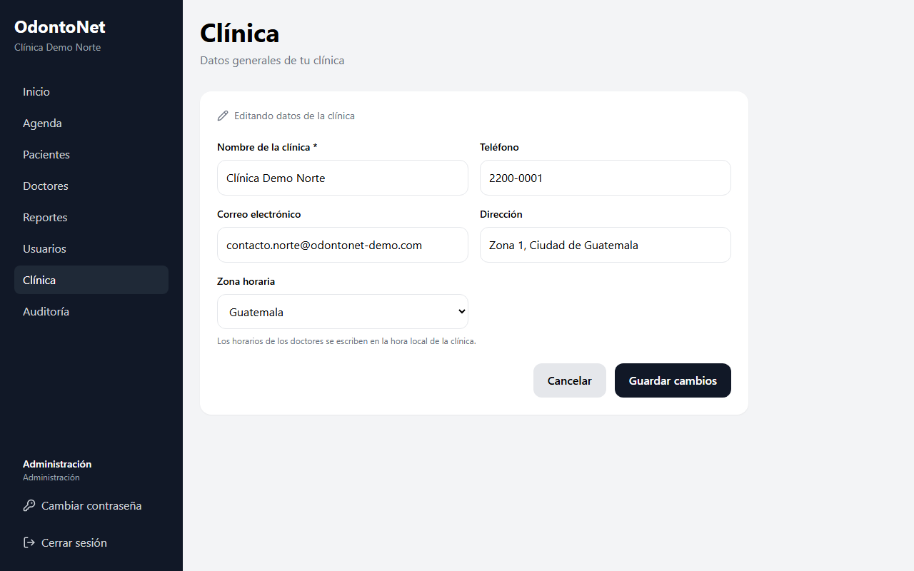

La **Zona horaria** es la que se usa para interpretar los horarios de los doctores. Revísala con cuidado antes de cambiarla.

## Reportes y exportación CSV

En el menú, pulsa **Reportes**. Muestra **Citas por periodo y estado**, **Citas e inasistencias por doctor** y **Pacientes nuevos**. Son datos agregados.

1. Elige el **Periodo** y, si quieres, un **Doctor**.
2. En **Agrupar**, elige **Por día**, **Por semana** o **Por mes**.
3. Pulsa **Ver como tabla** para ver las cifras exactas.

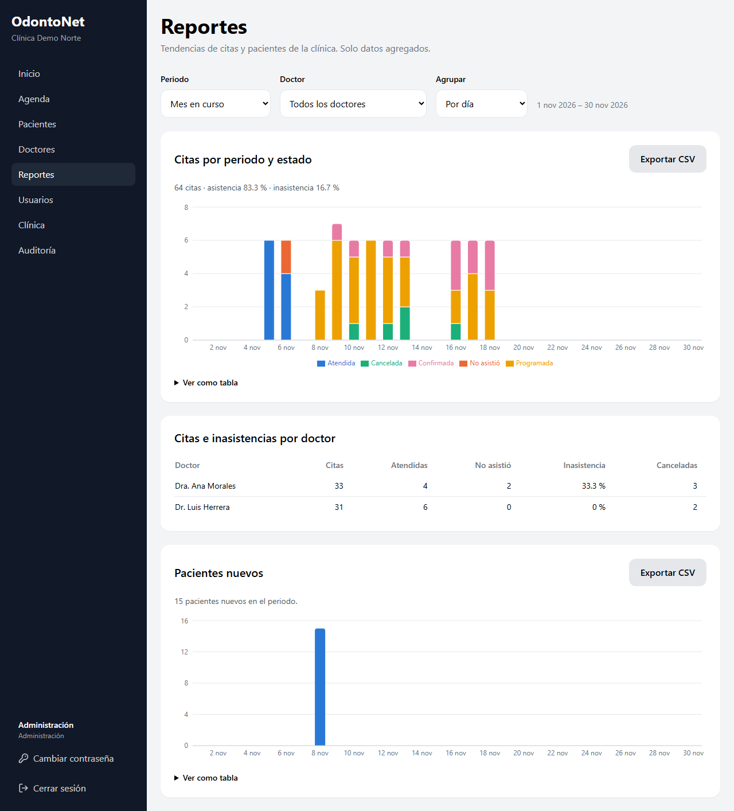

Para descargar un archivo que se abre con una hoja de cálculo, pulsa **Exportar CSV** en **Citas por periodo y estado** o en **Pacientes nuevos**. El archivo usa los filtros que tengas elegidos en ese momento. Solo administración puede exportar, y cada exportación queda registrada en la Auditoría.

## Auditoría

En el menú, pulsa **Auditoría** para ver quién cambió o exportó qué en la clínica. Los registros no se pueden editar ni borrar.

1. Filtra por **Desde**, **Hasta**, **Acción** o **Usuario**.
2. En cada fila, revisa la **Fecha y hora**, el **Usuario**, la **Acción**, el **Registro** y los **Campos** que cambiaron.
3. Si el registro corresponde a un paciente, pulsa **Ver paciente** para abrir su ficha.
4. Pulsa **Cargar más** para ver eventos anteriores.

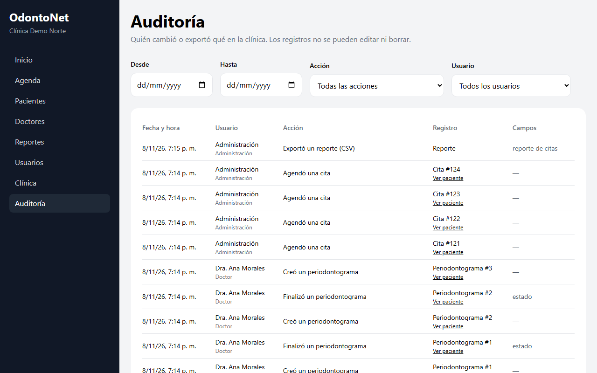

Por protección de los datos, la Auditoría muestra solo los nombres de los campos cambiados, nunca sus valores.

## Accesos a las fotografías

Para saber quién abrió el original de una fotografía clínica:

1. Abre la ficha del paciente y luego la pestaña **Imágenes**.
2. Pulsa la miniatura de la fotografía.
3. Pulsa **Accesos**. Verás a cada persona y la fecha en que la abrió.

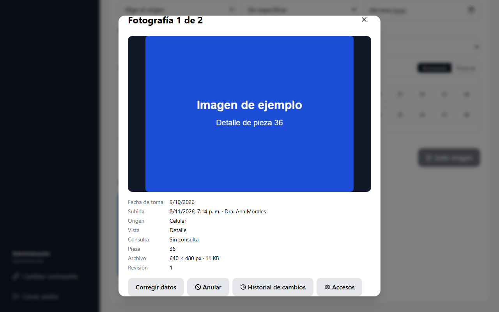

## Instalación y respaldos

La instalación del sistema y los respaldos de la información no se realizan desde la aplicación y no forman parte de este manual. Están en las guías técnicas [docs/DEPLOYMENT.md](../DEPLOYMENT.md) y [docs/BACKUPS.md](../BACKUPS.md), dirigidas a quien administra el servidor.
