# Manual del doctor

Con el rol **Doctor** atiendes a los pacientes y registras su expediente clínico. Para iniciar sesión, cambiar tu contraseña o recuperarla, consulta los [primeros pasos](README.md).

Los doctores comparten la información de su clínica: puedes consultar a todos los pacientes, no solo a los que tienes asignados. Lo que sí queda limitado a quien lo registró es editar o anular ciertos registros, como se indica en cada sección.

> **Importante.** OdontoNet es una herramienta de registro y de apoyo a tu trabajo. El periodontograma, sus resúmenes y sus comparaciones son datos descriptivos y **no constituyen un diagnóstico**. Todas las decisiones clínicas son del profesional que atiende.

## Inicio

Al entrar verás **Inicio**, enfocado en tus datos: en **Doctor** aparece tu nombre con **(yo)**.

1. Cambia el **Periodo** si quieres ver otro rango de fechas.
2. Elige **Todos los doctores** en **Doctor** para ver toda la clínica.
3. Pulsa **Mostrar más indicadores** para ver más cifras.
4. En **Agenda de hoy**, pulsa el nombre de un paciente para abrir su ficha.

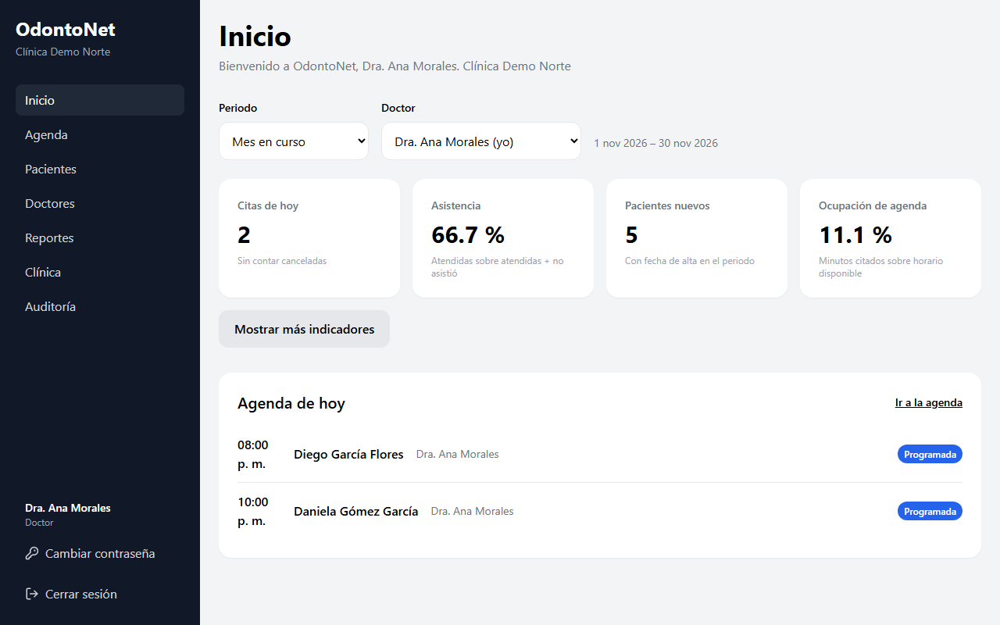

## Agenda

En el menú, pulsa **Agenda**. Muestra las citas de toda la clínica; usa el filtro o el botón con tu nombre para ver solo las tuyas.

- Pulsa **Nueva cita** para agendar, o selecciona un espacio libre del calendario. Busca al paciente, elige doctor, fecha, hora y duración, y pulsa **Agendar cita**. Si queda fuera del horario, puedes pulsar **Agendar de todas formas**.
- Pulsa una cita para ver su detalle. Desde ahí puedes pulsar **Reprogramar** o cambiar su estado: **Confirmar**, **Marcar atendida**, **Marcar no asistió** o **Cancelar cita**. Los botones que aparecen dependen del estado de la cita y de la hora.
- La pestaña **Por confirmar** lista las citas programadas pendientes de confirmar.

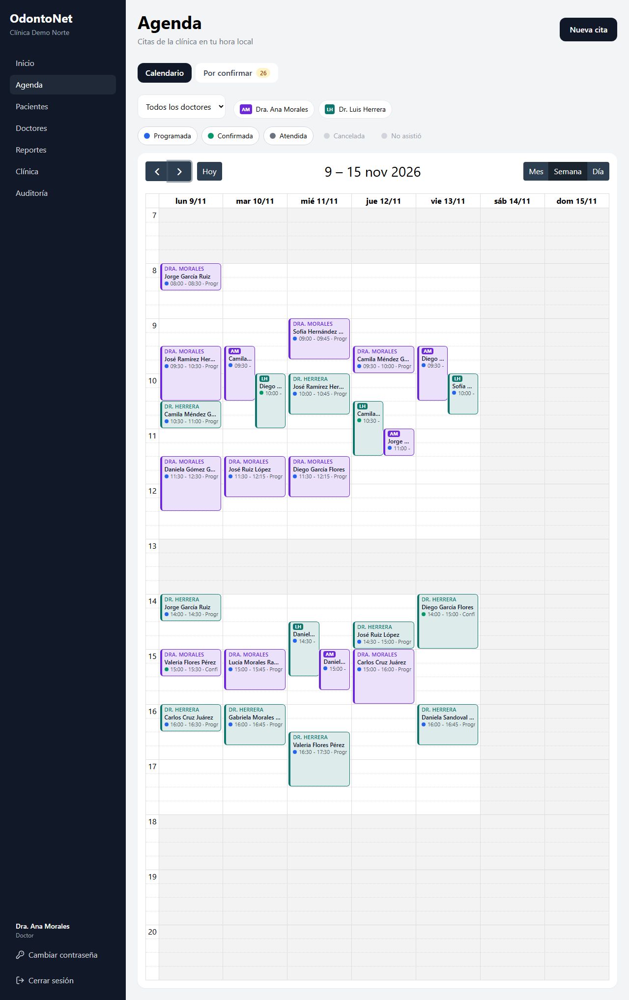

## La ficha del paciente

En el menú, pulsa **Pacientes**, busca al paciente y pulsa su nombre. La ficha se organiza en pestañas:

**Datos generales · Historia médica · Consultas · Tratamientos · Imágenes · Periodontograma · Historial**

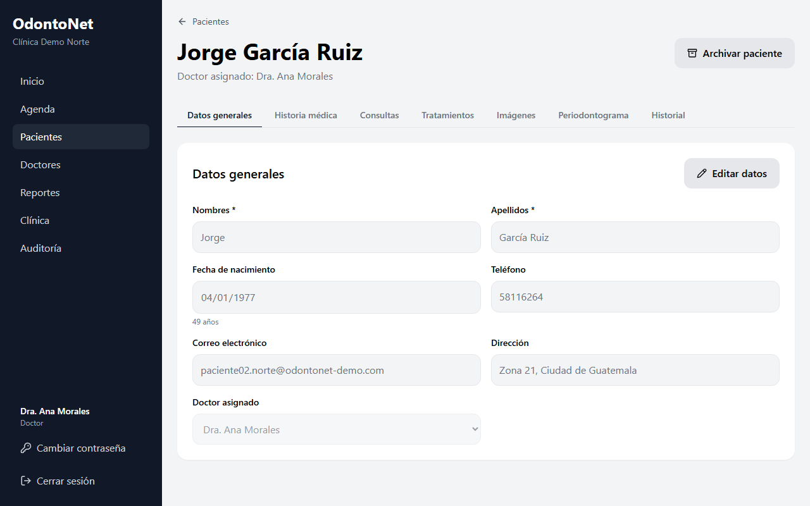

En **Datos generales** puedes pulsar **Editar datos** para corregir la información del paciente o cambiar el doctor asignado, y luego **Guardar cambios**. Con **Nuevo paciente** registras uno nuevo desde el listado. **Archivar paciente** lo saca del listado de activos sin borrar nada, siempre que no tenga citas próximas pendientes; un paciente archivado queda en modo de solo lectura hasta que se pulse **Reactivar paciente**.

## Historia médica

Cada vez que guardas, se crea una versión nueva y las anteriores se conservan.

1. Abre la pestaña **Historia médica**.
2. Pulsa **Registrar historia** (si es la primera vez) o **Editar historia**.
3. Completa los antecedentes médicos, los hábitos y los antecedentes odontológicos. En las opciones **Sin dato**, **No** y **Sí**, deja **Sin dato** lo que no hayas preguntado.
4. Pulsa **Guardar historia**.

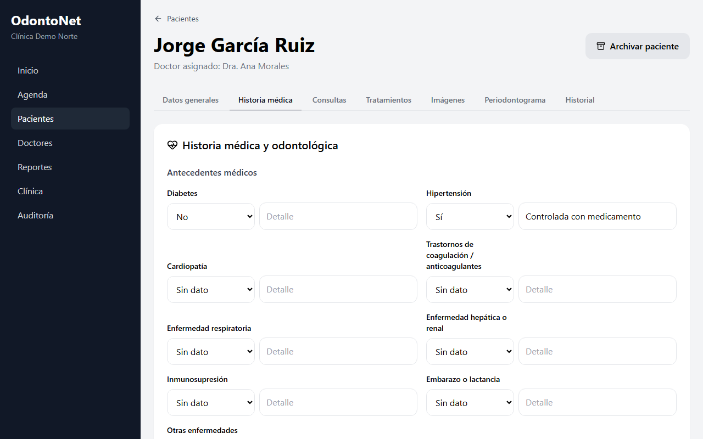

Si la historia tiene varias versiones, el selector junto al botón permite consultar las anteriores. Si otra persona guardó un cambio mientras editabas, el sistema te avisa para que revises la versión vigente antes de guardar.

## Consultas

### Registrar una consulta

1. Abre la pestaña **Consultas** y pulsa **Nueva consulta**.
2. Revisa **Fecha y hora de atención** y **Doctor** (se propone tu perfil).
3. Escribe el **Motivo de la consulta**, que es obligatorio.
4. Completa lo que corresponda: **Hallazgos / examen**, **Diagnóstico profesional**, **Procedimientos realizados**, **Indicaciones** y **Próxima cita sugerida**.
5. Pulsa **Registrar consulta**.

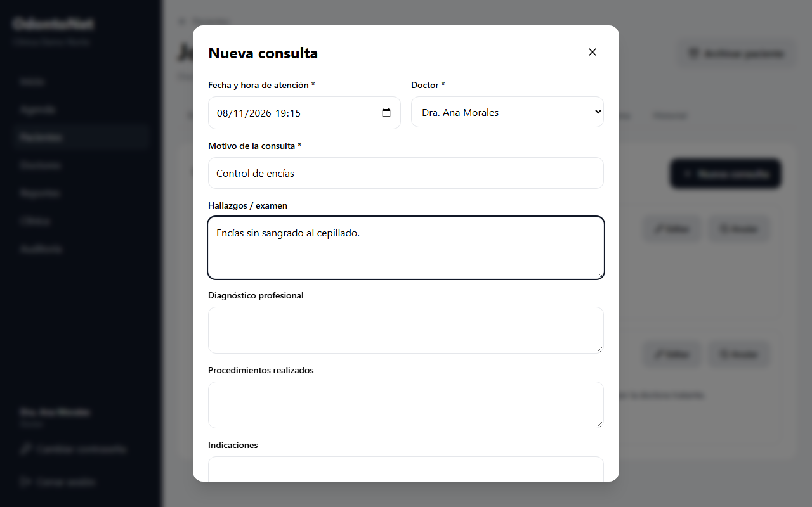

### Editar o anular una consulta

Solo puedes editar o anular las consultas que tú registraste.

- **Editar:** pulsa **Editar**, cambia lo necesario y pulsa **Guardar cambios**. El botón **Cambios** muestra todas las revisiones.
- **Anular:** pulsa **Anular**, escribe el **Motivo de la anulación** y pulsa **Anular consulta**. La consulta no se borra: queda visible como anulada, con tu nombre, la fecha y el motivo.

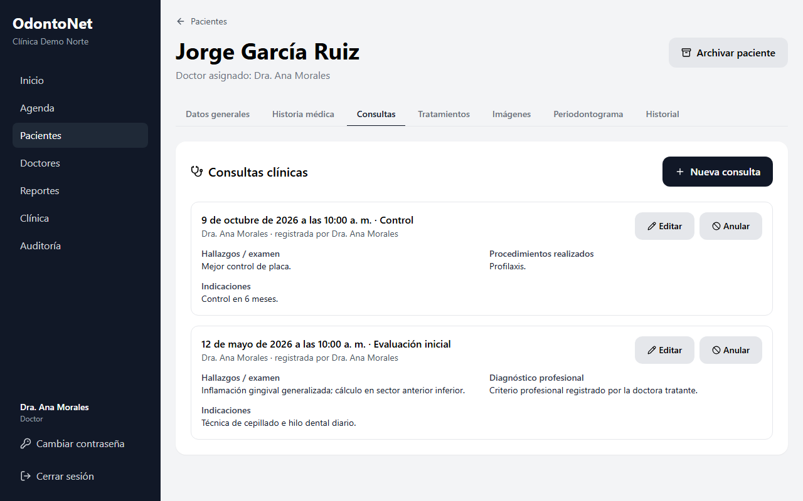

## Tratamientos

La pestaña **Tratamientos** muestra el **Plan de tratamiento**, separado en **Pendientes** y **Completados y cancelados**. Cualquier doctor de la clínica puede gestionarlo; el historial registra quién hizo cada cambio.

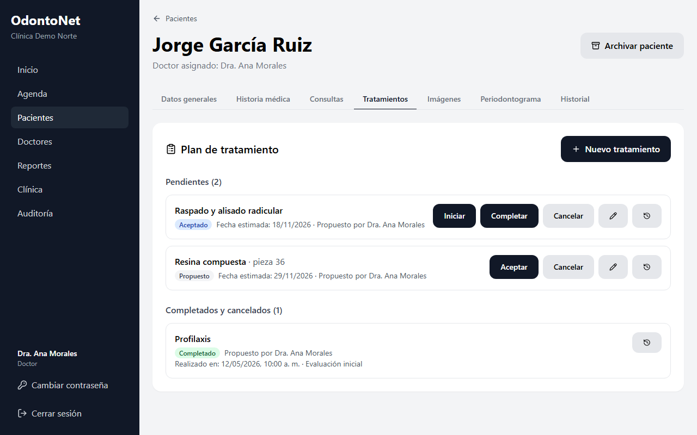

### Registrar un tratamiento

1. Pulsa **Nuevo tratamiento**.
2. Escribe el **Procedimiento**.
3. Si aplica, escribe la **Pieza dental (FDI)** o tócala en el **Odontograma** (**Permanente** o **Temporal**).
4. Completa, si quieres, **Fecha estimada**, **Consulta en que se propuso** y **Notas**.
5. Pulsa **Registrar tratamiento**. Queda como **Propuesto**.

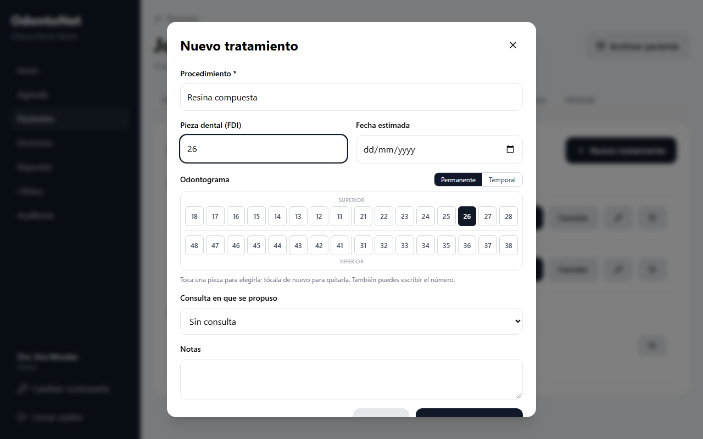

### Avanzar el estado

| Estado actual | Botones |
| --- | --- |
| Propuesto | **Aceptar**, **Cancelar** |
| Aceptado | **Iniciar**, **Completar**, **Cancelar** |
| En curso | **Completar**, **Cancelar** |

- **Completar** exige indicar la consulta en la que se realizó. Si todavía no existe, regístrala primero en **Consultas**. Luego pulsa **Marcar completado**.
- **Cancelar** exige un motivo. Después pulsa **Cancelar tratamiento**.
- El icono de lápiz edita un tratamiento pendiente y el icono de reloj muestra su historial. Un tratamiento completado o cancelado ya no cambia.

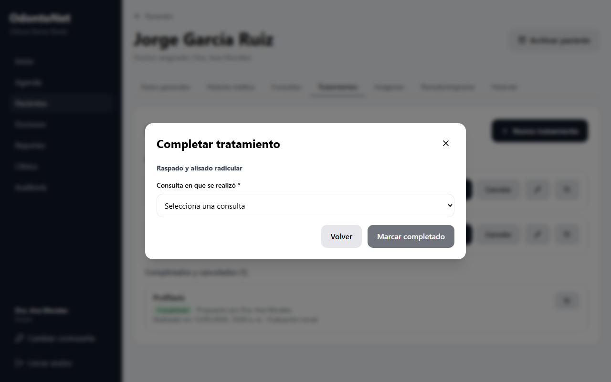

## Imágenes clínicas

La pestaña **Imágenes** reúne el consentimiento, la subida de fotografías y la galería.

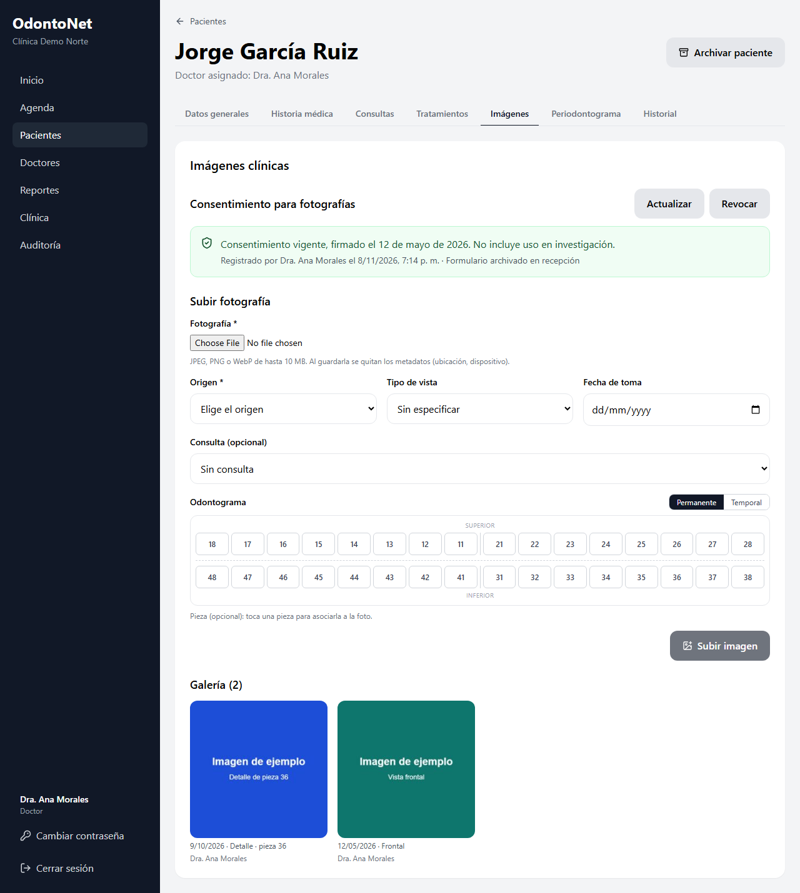

### Registrar el consentimiento

No se pueden subir fotografías sin un consentimiento vigente del paciente.

1. Pulsa **Registrar consentimiento** (o **Actualizar**, si ya existe).
2. Marca **El paciente autoriza fotografías clínicas**.
3. Marca **Autoriza además el uso en investigación** solo si el formulario firmado lo autoriza expresamente.
4. Indica la **Fecha del documento** y, si quieres, unas **Notas** (por ejemplo, dónde está archivado el formulario).
5. Pulsa **Guardar consentimiento**.

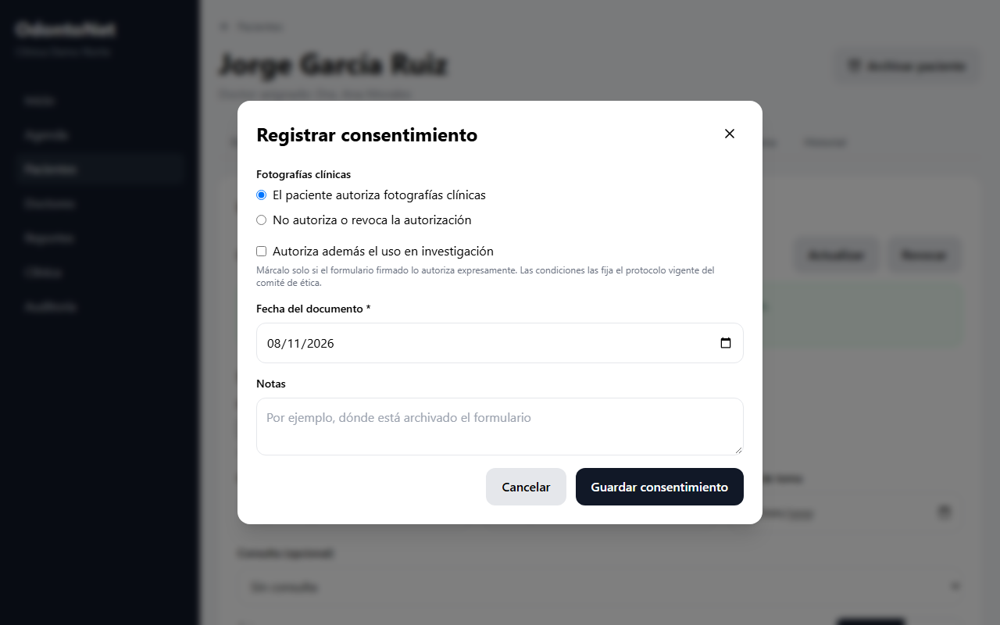

Si el paciente retira su autorización, pulsa **Revocar** y guarda: ya no se podrán subir fotografías nuevas. Cada cambio queda en el historial del consentimiento.

### Subir una fotografía

1. En **Subir fotografía**, elige el archivo en **Fotografía**. Se aceptan JPEG, PNG o WebP de hasta 10 MB. Al guardarla se quitan los metadatos del archivo, como la ubicación o el dispositivo.
2. Elige el **Origen**, que es obligatorio.
3. Completa, si quieres, **Tipo de vista**, **Fecha de toma**, **Consulta** y la pieza en el **Odontograma**.
4. Pulsa **Subir imagen**.

### Ver, corregir o anular una fotografía

Pulsa una miniatura de la **Galería** para abrirla. Con **Historial de cambios** ves las correcciones de sus datos.

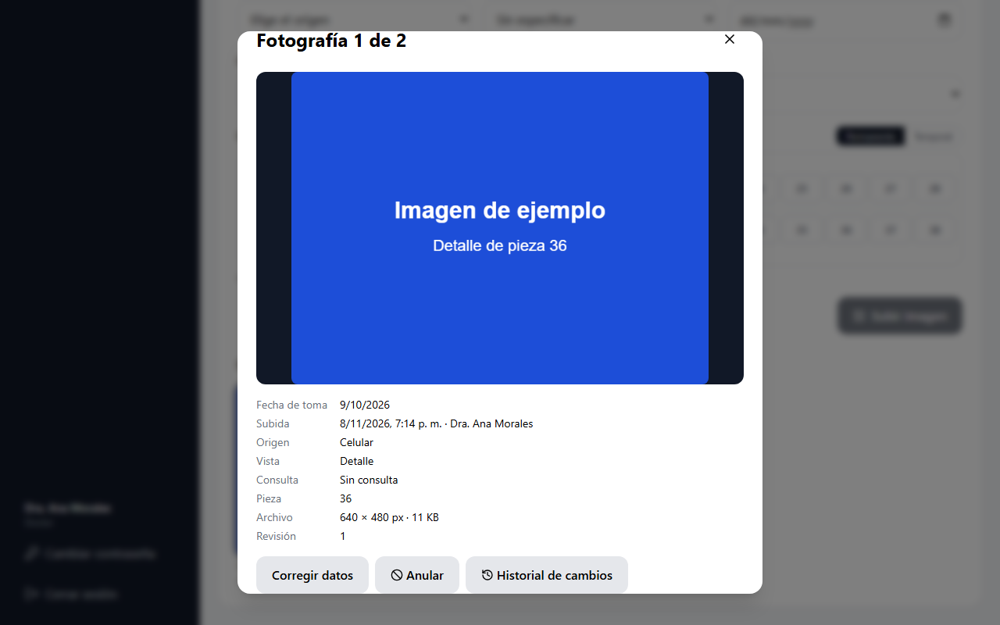

En las fotografías que tú subiste también puedes:

- **Corregir datos:** cambia origen, vista, fecha, consulta o pieza, y pulsa **Guardar corrección**. El archivo no cambia.
- **Anular:** escribe el **Motivo** y pulsa **Anular fotografía**. No se borra: deja de mostrarse en la galería, salvo que marques **Mostrar anuladas**.

## Periodontograma

La pestaña **Periodontograma** lista los exámenes del paciente, con su fecha, estado y un resumen. Es un registro manual por pieza y sitio. **Los resúmenes no constituyen diagnóstico.**

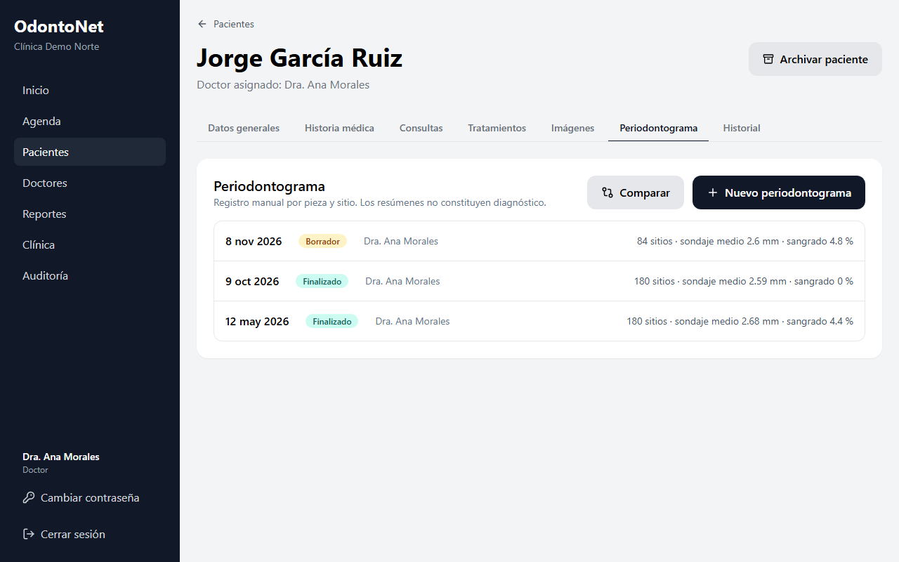

### Crear un examen

1. Pulsa **Nuevo periodontograma**.
2. Si el paciente ya tiene exámenes, elige **En blanco** o **A partir del examen** anterior y marca qué copiar:
   - **Estado dental (piezas ausentes e implantes)**
   - **Movilidad y furcaciones**
   - **Sondajes y márgenes gingivales**
   - **Sangrado, supuración y placa**
3. Pulsa **Crear**. Revisa cada valor copiado antes de finalizar; las notas no se copian.

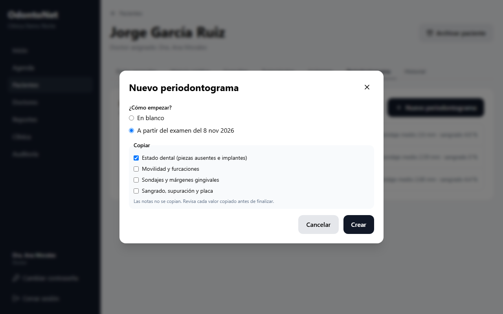

### Registrar las mediciones

El examen se abre como **Borrador**. Solo quien lo creó o administración puede editarlo.

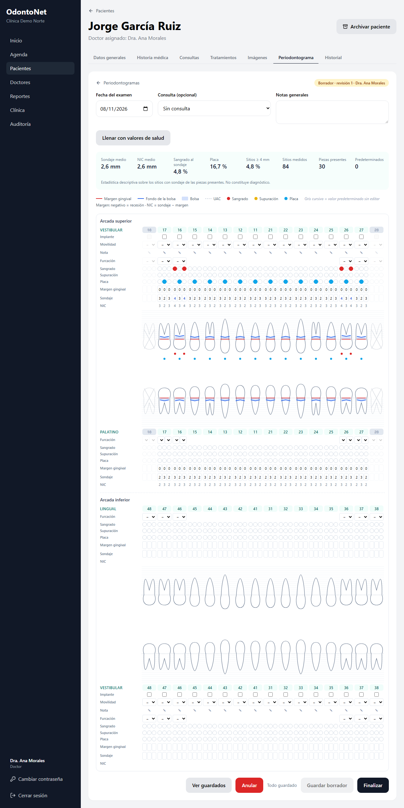

- Indica la **Fecha del examen** y, si quieres, la **Consulta** y unas **Notas generales**.
- **Sondaje** y **Margen gingival** (en mm) se escriben por sitio. El cursor avanza solo; también puedes moverte con las flechas o con Enter. Un margen negativo indica recesión. El **NIC** se calcula automáticamente (sondaje − margen).
- **Sangrado**, **Supuración** y **Placa**: toca el círculo del sitio para marcarlo.
- Toca el número de una pieza para marcarla como ausente. **Cuidado:** esto vacía todas sus mediciones, y volver a tocarla no las recupera.
- **Implante**, **Movilidad**, **Furcación** y **Nota** se registran por pieza. La nota se abre con el icono de lápiz.
- Los valores fuera de rango se marcan en rojo y hay que corregirlos antes de guardar.

El resumen y el dibujo se actualizan mientras escribes. El resumen es una estadística descriptiva de lo registrado.

### Guardar y finalizar

El borrador se guarda solo unos segundos después de cada cambio; junto a los botones verás **Todo guardado** o **Cambios sin guardar**. También puedes pulsar **Guardar borrador**. **Ver guardados** muestra cada revisión guardada.

Si se perdió la conexión o se recargó la pestaña, al volver a abrir el examen podrás pulsar **Recuperar cambios** o **Descartar**.

**Llenar con valores de salud** propone valores en los sitios vacíos de las piezas presentes que no son implantes, sin cambiar lo que ya escribiste, y movilidad 0 si la eliges. Quedan en gris cursiva como predeterminados hasta que los edites, y **Deshacer** los revierte hasta la siguiente edición.

Son valores **asumidos, no medidos**: cuentan en el resumen, en el PDF y para poder finalizar, aunque el resumen indica cuántos sitios son predeterminados. Con los valores propuestos (2 mm y margen 0), el NIC resultante es de 2 mm, que no significa «sin pérdida de inserción». La decisión clínica es tuya: revisa y corrige las piezas que lo necesiten.

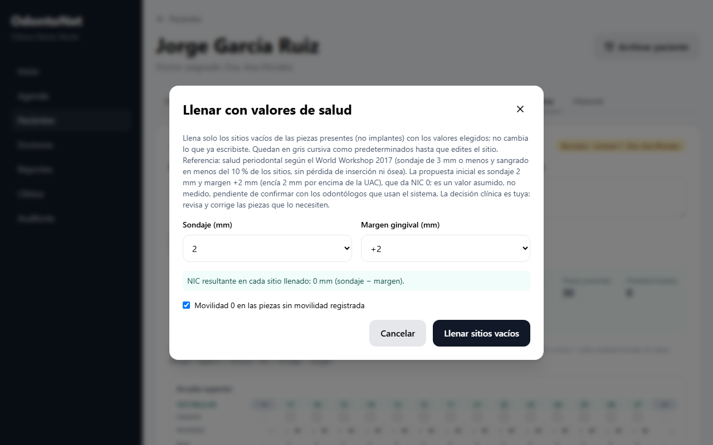

Cuando termines, pulsa **Finalizar** y confirma. Hace falta al menos un sondaje registrado.

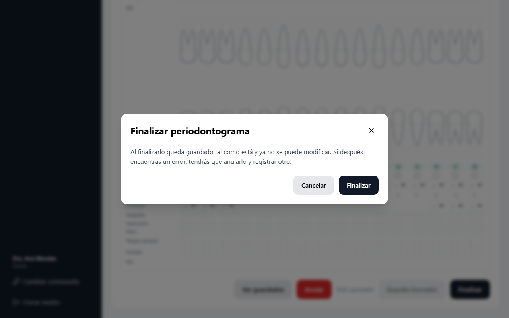

Un examen finalizado queda guardado tal como está y ya no se puede modificar. Si encuentras un error, quien lo registró o administración puede pulsar **Anular**, escribir el **Motivo**, pulsar **Anular periodontograma** y registrar otro. Anular no lo borra: queda en el historial como anulado.

### Reporte PDF

En un examen **Finalizado**, pulsa **Descargar PDF** para obtener el reporte.

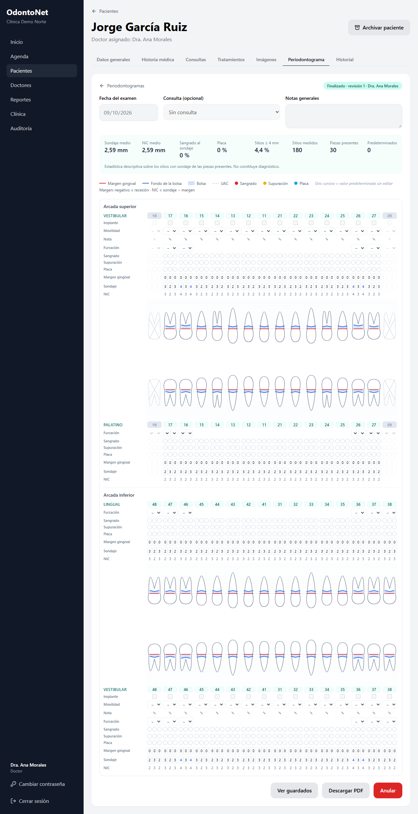

### Comparar dos exámenes

Con al menos dos exámenes finalizados y no anulados, pulsa **Comparar** y elige el **Primer examen** y el **Segundo examen**. Verás las diferencias en los indicadores, las piezas con cambios de sondaje destacados y la lista de **Sitios con cambios**. La comparación describe diferencias entre registros y no constituye diagnóstico.

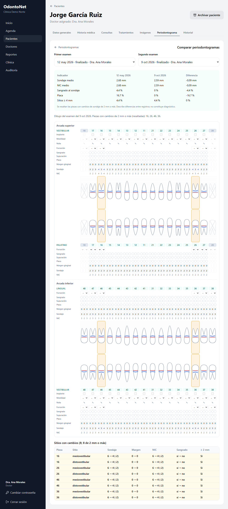

## Historial

La pestaña **Historial** reúne en una sola línea de tiempo las consultas, tratamientos, historia médica, citas, imágenes y periodontogramas del paciente. Usa las casillas de arriba para mostrar u ocultar cada tipo, y **Ver más** para cargar eventos anteriores.

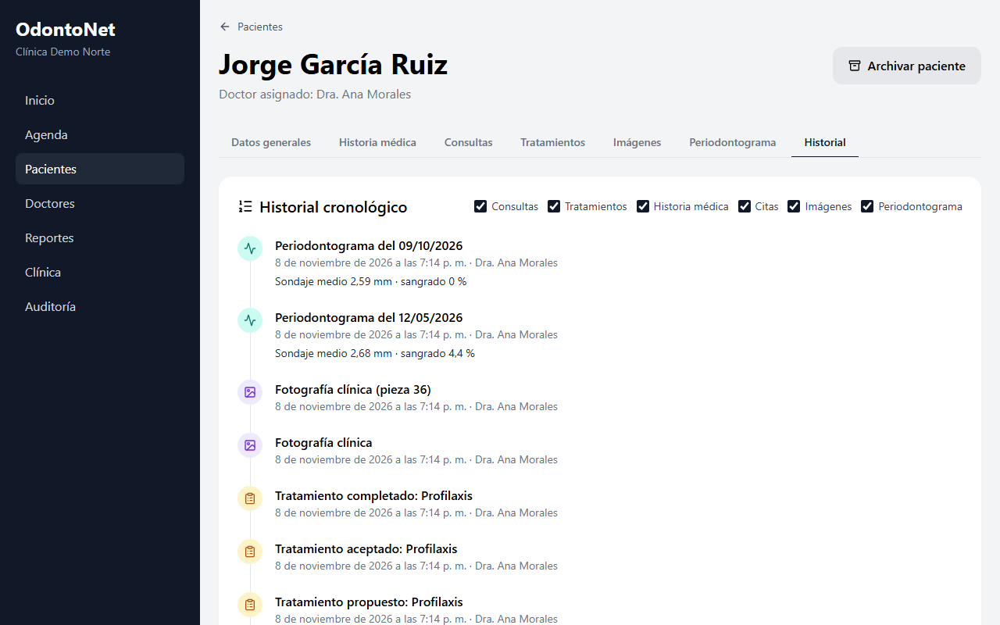

## Tu horario

Puedes editar tu propio horario; el de los demás doctores solo puedes consultarlo.

1. En el menú, pulsa **Doctores** y luego el icono de reloj en tu fila.
2. Ajusta las horas de cada día. **Bloque** agrega un periodo de atención y la papelera lo quita. **Copiar lunes a martes–viernes** repite el lunes en los demás días hábiles.
3. Pulsa **Guardar horario**.

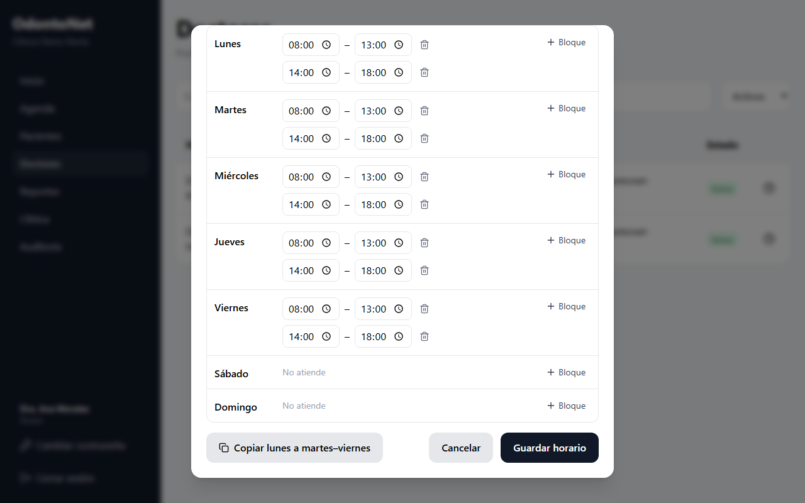

Las horas van en la hora local de la clínica. Fuera de tu horario, la agenda pide confirmar antes de agendar.

## Reportes

En el menú, pulsa **Reportes**. Al entrar se filtra por ti; elige **Todos los doctores** para ver la clínica completa. Puedes cambiar el **Periodo**, elegir **Agrupar** por día, semana o mes, y pulsar **Ver como tabla** para ver las cifras exactas. Son datos agregados. La exportación a archivo está reservada a administración.

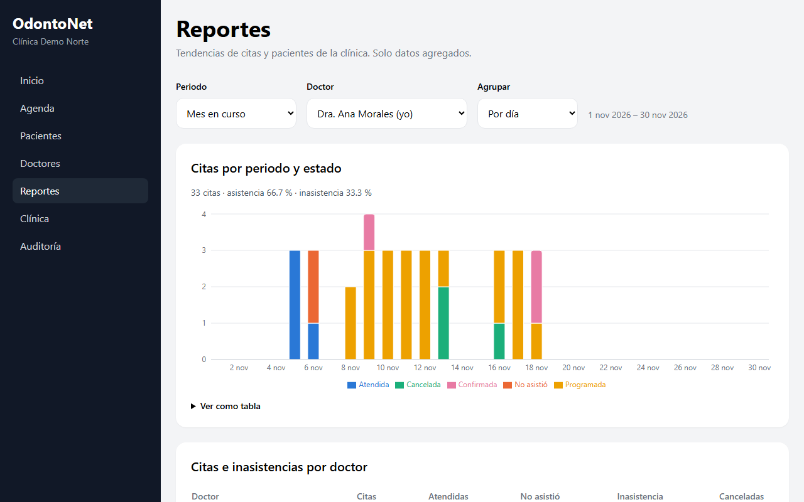

## Datos de la clínica

En el menú, pulsa **Clínica** para consultar los datos generales. Solo administración puede modificarlos.

## Auditoría

En el menú, pulsa **Auditoría** para consultar tus propios cambios y exportaciones. Puedes filtrar por **Desde**, **Hasta** y **Acción**. Se muestra qué campos cambiaron, nunca sus valores. Los registros no se pueden editar ni borrar.

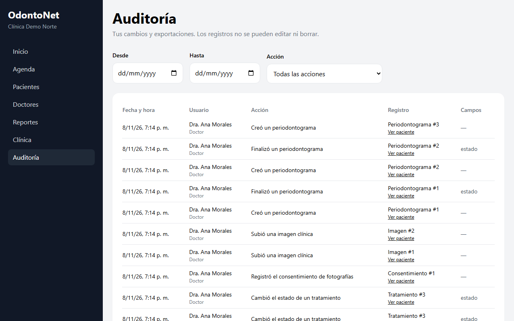
