# Manual de recepción

Con el rol **Recepción** gestionas la agenda, los datos generales de los pacientes y los horarios de los doctores. Para iniciar sesión, cambiar tu contraseña o recuperarla, consulta los [primeros pasos](README.md).

## Qué puedes y qué no puedes hacer

| Puedes | No puedes |
| --- | --- |
| Agendar, reprogramar, confirmar y cancelar citas | Ver consultas clínicas |
| Registrar, editar, archivar y reactivar pacientes | Ver tratamientos |
| Consultar la historia médica (solo lectura) | Ver imágenes clínicas |
| Editar el horario de cualquier doctor | Ver periodontogramas ni el historial clínico |
| Consultar reportes y los datos de la clínica | Editar la historia médica, exportar reportes o gestionar usuarios |

### Por qué recepción no ve la información clínica

Las consultas, los tratamientos, las imágenes y el periodontograma son información de salud del paciente. Solo la consultan quienes lo atienden: doctores y administración. Las notas de una consulta, un plan de tratamiento o una fotografía clínica no hacen falta para organizar la agenda, y limitar quién puede verlas protege la confidencialidad del paciente y a la propia clínica.

Por eso, en la ficha del paciente solo aparecen las pestañas **Datos generales** e **Historia médica**. La historia médica sí está disponible en modo de solo lectura, para que conozcas alergias y condiciones importantes al agendar o recibir al paciente.

Si un paciente te pide información de su expediente, remítelo a su doctor. Si intentas entrar a una sección que tu rol no permite, verás **Acceso denegado**.

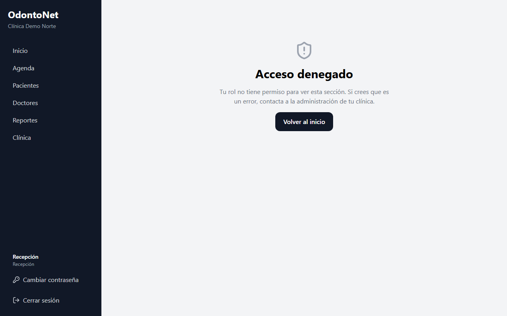

## Inicio

Es la primera pantalla al entrar. Muestra cifras de la clínica y la **Agenda de hoy**.

1. Elige el **Periodo** (por ejemplo, **Mes en curso**) y, si quieres, un **Doctor**.
2. Pulsa **Mostrar más indicadores** para ver más cifras. Son cantidades totales, sin datos de ningún paciente.
3. En **Agenda de hoy**, pulsa el nombre de un paciente para abrir su ficha, o **Ir a la agenda** para ver el calendario.

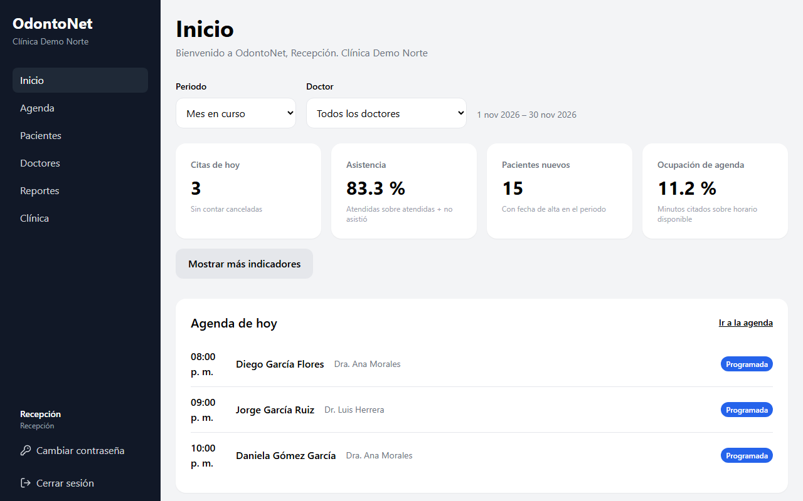

## Agenda

### Ver las citas

En el menú, pulsa **Agenda**. La pestaña **Calendario** muestra las citas de toda la clínica, en la hora local de tu equipo.

- Usa los botones de la parte superior del calendario para cambiar de semana, volver a **Hoy** o ver **Mes**, **Semana** o **Día**.
- Filtra con **Todos los doctores** o con el botón con el nombre de un doctor. Cada doctor tiene un color.
- Los botones de estado (**Programada**, **Confirmada**, **Atendida**, **Cancelada**, **No asistió**) muestran u ocultan las citas de ese estado. Al entrar, las canceladas y las de «No asistió» están ocultas porque no ocupan el horario.
- Las horas sombreadas están fuera del horario de atención de los doctores.

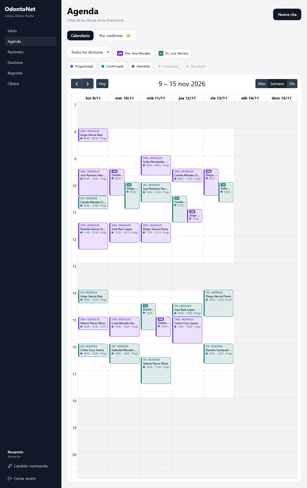

### Agendar una cita

1. Pulsa **Nueva cita**. También puedes seleccionar un espacio libre en el calendario, y la fecha y hora se llenan solas.
2. En **Paciente**, escribe el nombre, el correo o el teléfono, y elige al paciente en la lista.
3. Elige el **Doctor**, la **Fecha**, la **Hora** y la **Duración**.
4. Si quieres, escribe el **Motivo** (limpieza, control, evaluación...).
5. Pulsa **Agendar cita**.

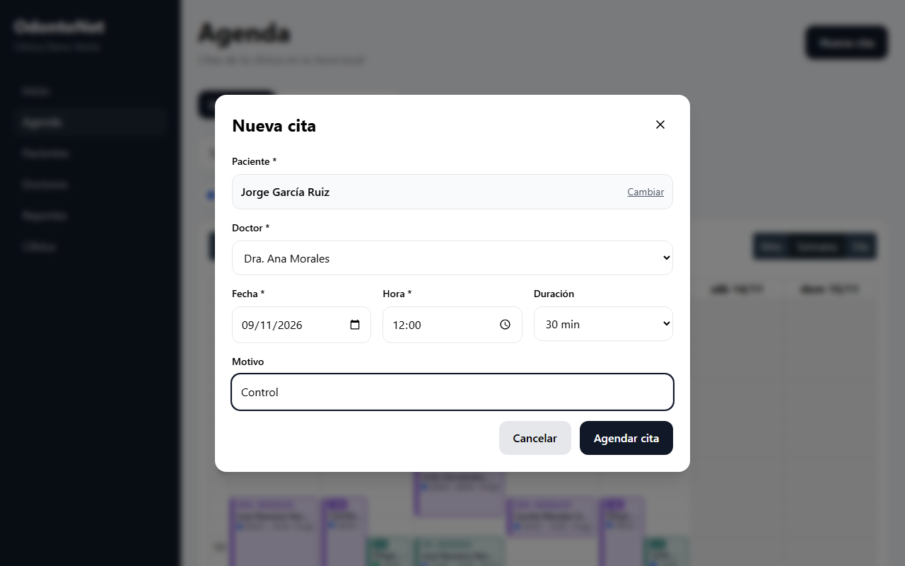

Si algo impide guardarla, el sistema te avisa:

- **El doctor o el paciente ya tienen una cita a esa hora.** El aviso indica con quién se cruza; elige otro horario.
- **Está fuera del horario del doctor.** El aviso muestra su horario de ese día. Si de todos modos debes agendarla, pulsa **Agendar de todas formas**.

Solo se pueden agendar citas a futuro, y solo a pacientes activos.

### Ver el detalle y cambiar el estado

Pulsa una cita en el calendario para abrir su **Detalle de la cita**. Abajo verás los botones disponibles y el **Historial** de cambios. Al elegir un cambio de estado puedes escribir una nota; no incluyas datos clínicos en ella.

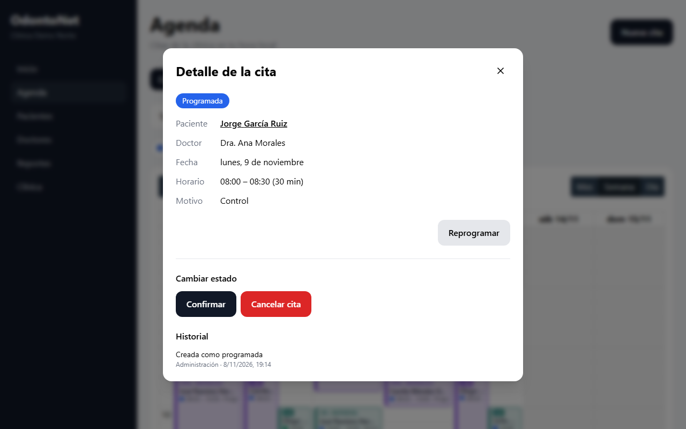

| Estado actual | Botones | Cuándo aparecen |
| --- | --- | --- |
| Programada | **Confirmar**, **Cancelar cita** | Antes de que termine la cita |
| Programada | **Marcar atendida**, **Marcar no asistió** | Desde que empieza la cita |
| Confirmada | **Quitar confirmación**, **Cancelar cita** | Antes de que termine la cita |
| Confirmada | **Marcar atendida**, **Marcar no asistió** | Desde que empieza la cita |
| Cancelada | **Reactivar** | Si la cita todavía no empieza |
| Atendida | **Marcar no asistió** | Para corregir un error |
| No asistió | **Marcar atendida** | Para corregir un error |

Las citas no se borran: se cancelan. Cancelar libera el horario.

### Reprogramar una cita

Se puede reprogramar una cita **Programada** o **Confirmada** que todavía no empieza. El paciente de la cita no cambia.

**Desde el detalle:**

1. Abre la cita y pulsa **Reprogramar**.
2. Cambia el doctor, la fecha, la hora o la duración.
3. Pulsa **Guardar cambios**.

**En el calendario:** arrastra la cita a otro horario, o estira su borde inferior para cambiar la duración. Si queda fuera del horario del doctor, elige **Mover de todas formas** o **Dejar como estaba**.

### Confirmar las citas por teléfono

1. En la Agenda, abre la pestaña **Por confirmar**. El número en la pestaña indica cuántas citas faltan por confirmar en los próximos 7 días.
2. Elige el **Periodo** (por ejemplo, **Hoy y mañana**).
3. Llama al número que aparece junto al paciente.
4. Según su respuesta, pulsa **Confirmar** o **Cancelar**. Al cancelar puedes escribir un motivo opcional y luego pulsar **Cancelar cita**. **Volver** cierra el aviso sin cancelar.

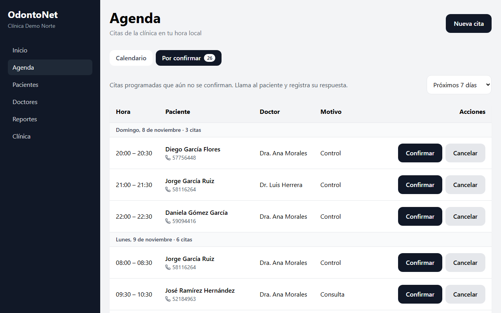

## Pacientes

### Buscar un paciente

En el menú, pulsa **Pacientes**. Escribe en el buscador el nombre, el correo o el teléfono. También puedes filtrar por doctor y elegir **Activos** o **Archivados**.

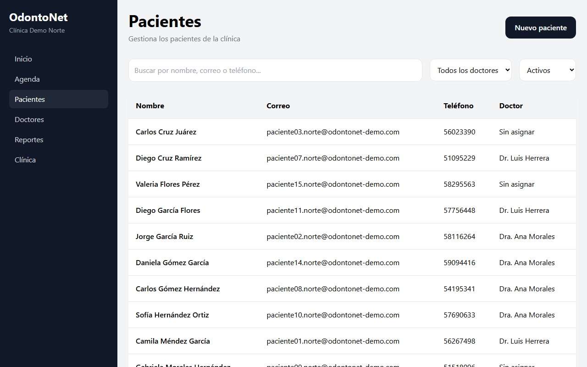

Pulsa el nombre de un paciente para abrir su ficha.

### Registrar un paciente nuevo

1. Pulsa **Nuevo paciente**.
2. Escribe **Nombres** y **Apellidos**, que son obligatorios.
3. Completa, si los tienes, **Fecha de nacimiento**, **Teléfono**, **Correo electrónico** y **Dirección**.
4. Elige el **Doctor asignado**, o déjalo en **Sin asignar**.
5. Pulsa **Guardar paciente**.

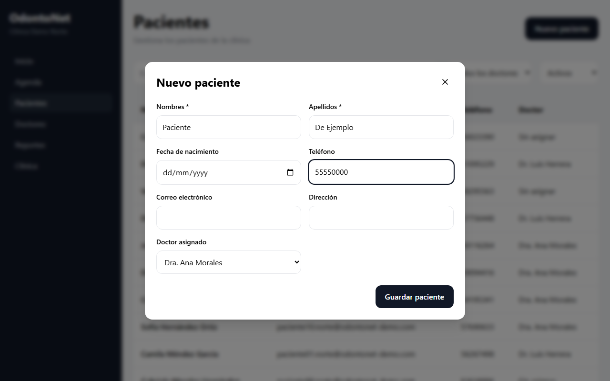

### Editar los datos de un paciente

1. Abre la ficha. En **Datos generales**, pulsa **Editar datos**.
2. Cambia lo que necesites, incluido el **Doctor asignado**.
3. Pulsa **Guardar cambios**, o **Cancelar** para dejarlo como estaba.

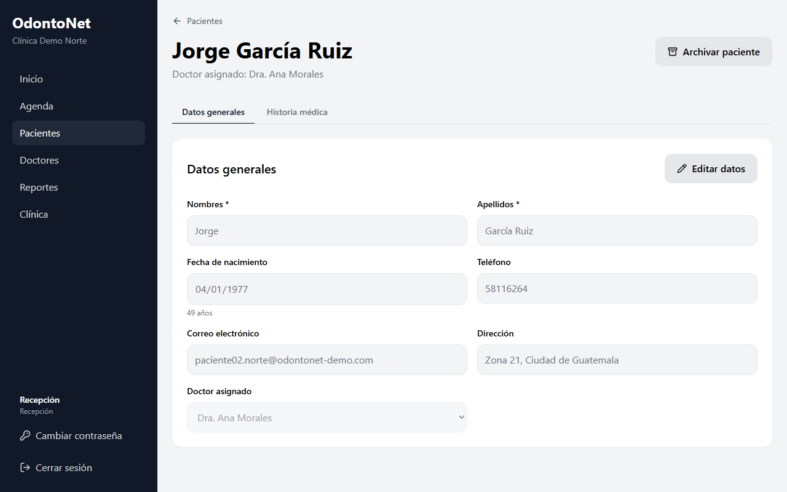

### Consultar la historia médica

Abre la pestaña **Historia médica** para ver antecedentes, alergias y medicamentos. Aparece **Solo lectura** porque la registran y actualizan los doctores. Si un paciente te informa de un cambio (una alergia nueva, por ejemplo), avísale a su doctor.

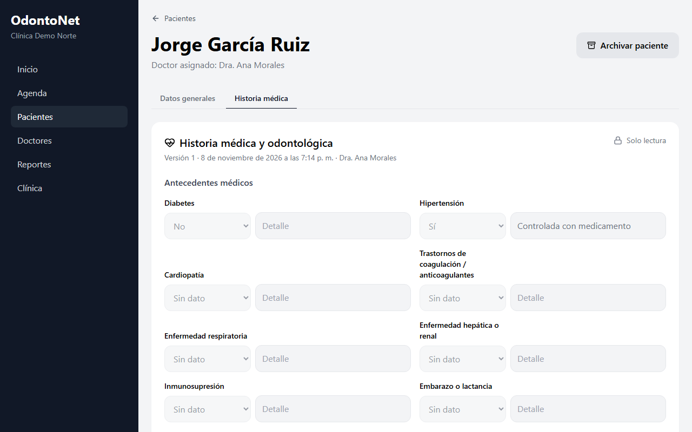

Si la historia tiene varias versiones, puedes consultar las anteriores en el selector de versión.

### Archivar y reactivar un paciente

Archivar saca al paciente del listado de activos, sin borrar nada.

1. Abre la ficha y pulsa **Archivar paciente**.
2. Lee el aviso y pulsa **Archivar**.

No se puede archivar un paciente con citas próximas pendientes: primero cancélalas o reprográmalas según corresponda. Un paciente archivado queda en modo de solo lectura y no se le pueden agendar citas.

Para recuperarlo, en **Pacientes** elige **Archivados**, abre su ficha, pulsa **Reactivar paciente** y confirma con **Reactivar**.

## Doctores y sus horarios

En el menú, pulsa **Doctores** para ver a los profesionales de la clínica, su especialidad y sus datos de contacto.

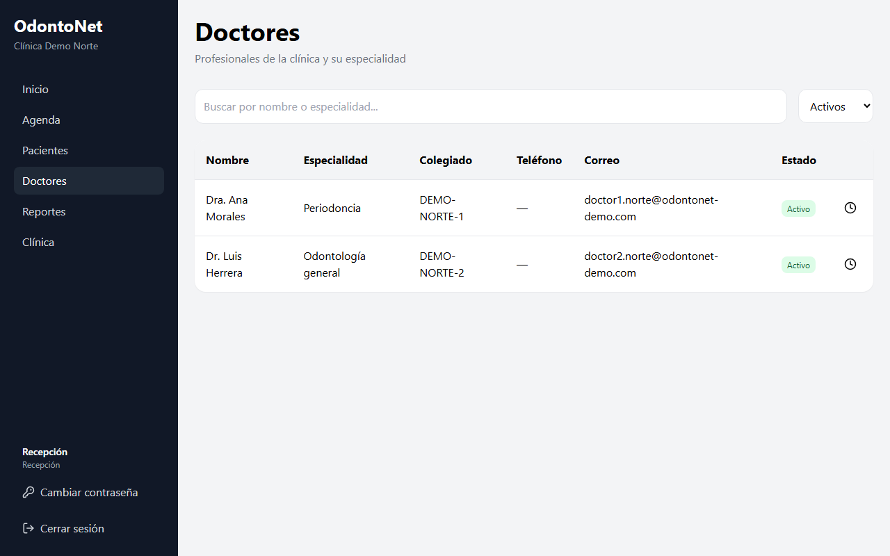

El horario se usa para sombrear la agenda y avisar cuando una cita queda fuera de él. Un doctor sin horario registrado se puede agendar a cualquier hora. Las horas se escriben en la hora local de la clínica.

1. Pulsa el icono de reloj en la fila del doctor.
2. Ajusta las horas de cada día:
   - **Bloque** agrega un nuevo periodo de atención en ese día.
   - El icono de papelera quita un bloque. Un día sin bloques aparece como **No atiende**.
   - **Copiar lunes a martes–viernes** repite el horario del lunes en los demás días hábiles.
3. Pulsa **Guardar horario**.

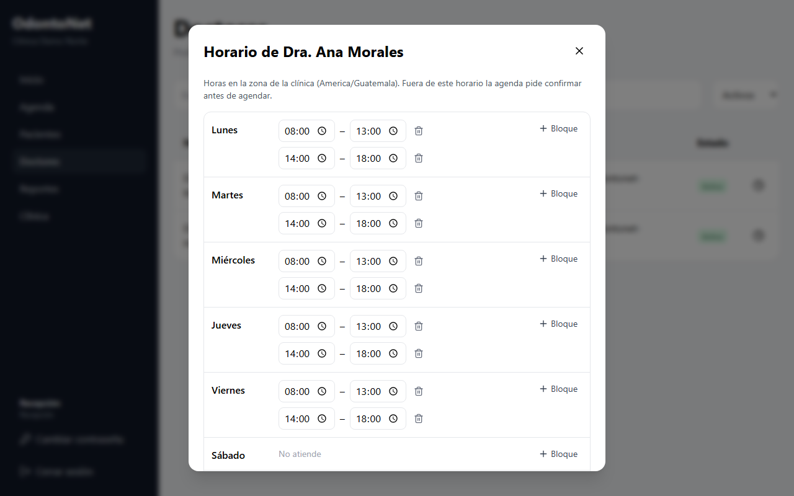

Los bloques de un mismo día no pueden cruzarse. Por ahora, el horario es semanal: no incluye vacaciones ni permisos.

## Reportes

En el menú, pulsa **Reportes** para ver la evolución de las citas y los pacientes nuevos. Son datos agregados: no muestran información de pacientes concretos.

1. Elige el **Periodo** y, si quieres, un **Doctor**.
2. En **Agrupar**, elige **Por día**, **Por semana** o **Por mes**.
3. Pulsa **Ver como tabla** para ver las cifras exactas de un gráfico.

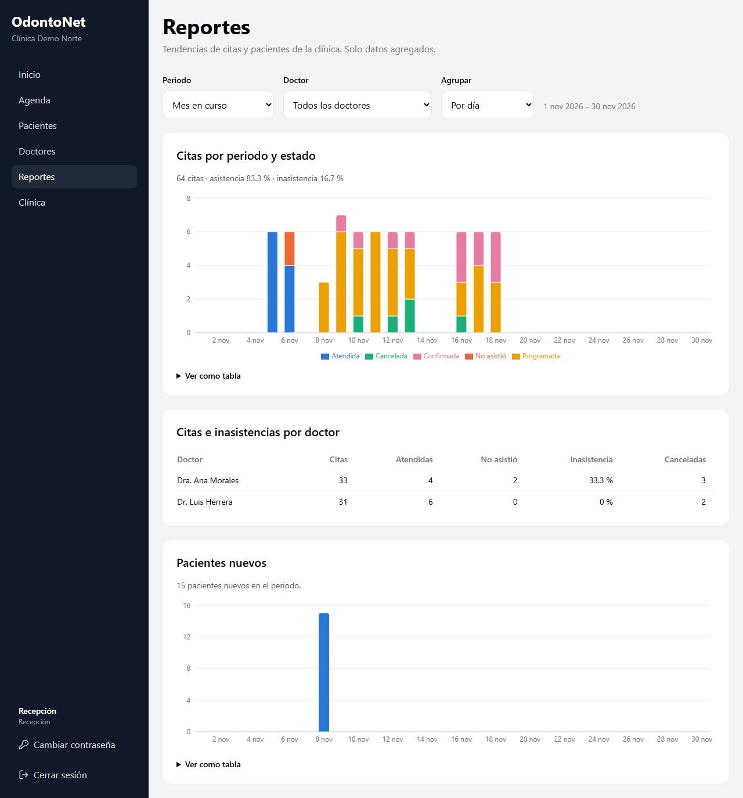

La exportación a archivo está reservada a administración.

## Datos de la clínica

En el menú, pulsa **Clínica** para consultar el nombre, teléfono, correo, dirección y zona horaria. Solo administración puede modificarlos.

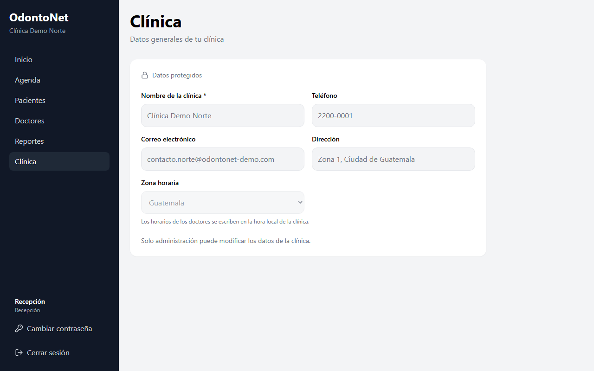
